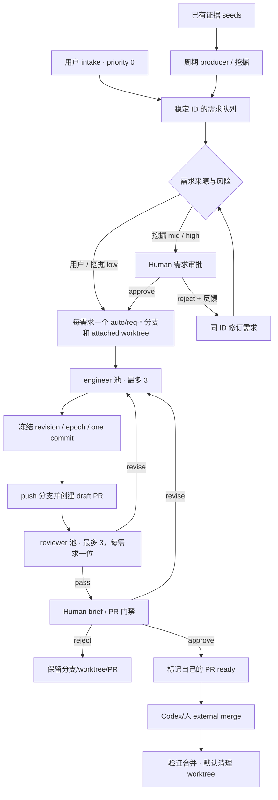

# dsh-auto-workflow

**dsh-auto-workflow**是 DeepSeek Harness 的持久化、并发节点图工作流插件。它让模型、命令和人工决策在同一张图中协作：新任务以独立 packet 进入，某项等待 Human 审批时，其他任务仍可继续。

**“Auto”指已授权流程的持续调度，不是免审批。** Host 常驻期间，空闲或 Human 等待不会结束运行；状态与数据引用会落盘。Host 停止、插件重载或执行中断后，不自动重放不确定的工作，也不承诺跨 Git/HTTP 的掉电事务。

当前发布为 **v1.0.1**；首个公开发布为 **v1.0.0**。仓库地址为 [lyingloong/dsh-auto-workflow](https://github.com/lyingloong/dsh-auto-workflow)，项目页为 [lyingloong.github.io/dsh-auto-workflow](https://lyingloong.github.io/dsh-auto-workflow/)。

## 安装

要求 Node.js **22.5+**、DeepSeek Harness **0.2.1-rc.5+**（首发已验证 rc.5）；开发示例还需要 Git 和可用的模型工具环境。以下使用 `desktop` profile，请按实际配置替换。

推荐固定 release，避免随开发分支变化：

```bash
dsh plugin --profile desktop add github:lyingloong/dsh-auto-workflow#v1.0.1
```

也可从 [v1.0.1 Release](https://github.com/lyingloong/dsh-auto-workflow/releases/tag/v1.0.1) 下载 `.tgz`，或安装本地 checkout：

```bash
dsh plugin --profile desktop add /absolute/path/dsh-auto-workflow-1.0.1.tgz
dsh plugin --profile desktop add /absolute/path/dsh-auto-workflow
```

安装后重启 DSH Host，再刷新 Web GUI。安装插件**不会**把示例脚本复制到业务仓库，也不会自动启动工作流。

## 快速使用：持续开发一个本地 GitHub clone

唯一主示例是 [GitHub 项目持续开发](<docs/examples/development/README.md>)：工作流自己维护每需求分支、worktree 和 PR，外部 Codex/人可以审核并 merge 该 PR。

1. **准备项目**：克隆你有权修改的 GitHub 仓库，配置 `origin` 和 `gh auth login`（或 `GITHUB_TOKEN`）；把示例脚本 materialize 到项目内并本地提交，使 checkout 干净。选择项目外的绝对、canonical `dataRoot`。
2. **输入真实需求**：初始化业务存储（会放入 baseline discovery seeds），提交用户需求；可选用 `driver seed` 补充相关证据 seed。用户需求优先级固定为 `0`；示例不监听所有聊天，也不自动抓取 GitHub Issues。
3. **授权并定义**：检查 [示例图](<docs/examples/development/workflow.json>) 与模型提示词，明确批准命令 allowlist，再调用 `auto_workflow_define`。HTTP 默认拒绝；agent 工具权限另行控制。
4. **开始运行**：`auto_workflow_start` 绑定项目的绝对 `cwd` 和 `{ "dataRoot": "…" }`；`auto_workflow_run` 挂载运行。在同一 run 中向 `mine-gate` **仅 enqueue 一次** producer，后续需求继续送入现有运行。
5. **审核与合并**：每个需求在 `auto/req-<id>` 分支和独立 worktree 中开发；第一次 snapshot 后推送分支并创建 draft PR。review pass + 结构化 brief 后 PR 标记 ready，外部 Codex/你可以直接 merge。若宽限期 `selfMergeAfterMs` 内仍未 merge，才进入 `self-merge-human`；Human 同意后工作流自己用 merge commit merge 该 PR，再验证并清理 worktree。默认 `after-verified-merge` 会删除 worktree（含开发期临时文件），提交和不可变记录保留。

### 主业务图



根并发上限为 **6**；命令和挖掘也共享这六个槽位。3+3 是两个工作池上限，不是每项需求三位 reviewer。返修保留同一需求 ID、分支、worktree 和 PR；snapshot 把分支压成一个 commit。完整语义见 [业务流程与保证](<docs/workflow-summary.md>)。

## 七个工具

| Tool | 用途 |
| --- | --- |
| `auto_workflow_define` | 校验并保存节点图和用户批准的权限。 |
| `auto_workflow_start` | 绑定不可变项目 `cwd`、预检并创建 run；不执行节点。 |
| `auto_workflow_run` | 挂载或继续当前会话的常驻 job，立即返回。 |
| `auto_workflow_enqueue` | 向现有 run 添加独立 packet；新工作不靠重启 run 输入。 |
| `auto_workflow_decide` | 解决一个指定 Human token，不代替其他审批。 |
| `auto_workflow_control` | 全局暂停/继续、单节点队列开关，或显式 Stop。 |
| `auto_workflow_status` | 只读查看队列、并发、Human 待办和私有看板 URL。 |

节点类型包括 `agent`、`command`、`http`、`human`、`fanout`、`join`、`gate`、`subworkflow`。字段与协议见 [插件参考](<docs/plugin-summary.md>)；不要循环轮询 `run`。

## 看板

- **Human 待处理详情**：点“查看详情与输入”打开独立卡片，按需读取该 token 的输入 JSON，并在同一处填写留言、查看 outcome 后决策。
- **节点图模式**：工具栏“简化”隐藏 `busy-*` 重试门，只保留业务节点；“完整”显示全部边。
- **节点方块**：每个节点是一个圆角方块，空闲/运行/等待/错误/关闭使用不同颜色；点击方块打开节点详情、数据包和历史。

## 边界与验证

- 插件负责通用调度和引用；需求优先级、Git worktree、审查与合并策略属于示例业务代码。
- command/HTTP 权限默认 deny。命令 allowlist 不是文件系统沙箱，也不替代 agent 工具权限。
- 暂停和禁用节点不会取消在途工作；Stop 不等于回滚。失败或中断后先检查副作用，再显式恢复或新建 run。
- 单 Host、本地文件锁；不是分布式队列、外部审批服务或 exactly-once Git/HTTP 事务。工作流会 push 自己的需求分支并创建/更新 PR，但不会 merge 远端、不会自行批准 GitHub PR，也不会部署。
- 包版本 `1.0.1`、定义 `apiVersion: 2`、运行状态 `version: 3`、示例业务存储 `version: 2` 是不同层的版本号，不要求相同。废弃开发序列与迁移边界见 [更新记录](<CHANGELOG.md>)。

已验证范围、真实模型执行概况与限制集中在 [验证说明](<docs/verification.md>)。从源码 checkout 运行完整回归：

```bash
npm test
```

继续阅读：[文档导航](<docs/README.md>) · [运行生命周期与排障](<docs/run-lifecycle.md>) · [v1.0.1 发布说明](<docs/releases/v1.0.1.md>) · [v1.0.0 历史发布](<docs/releases/v1.0.0.md>)。
